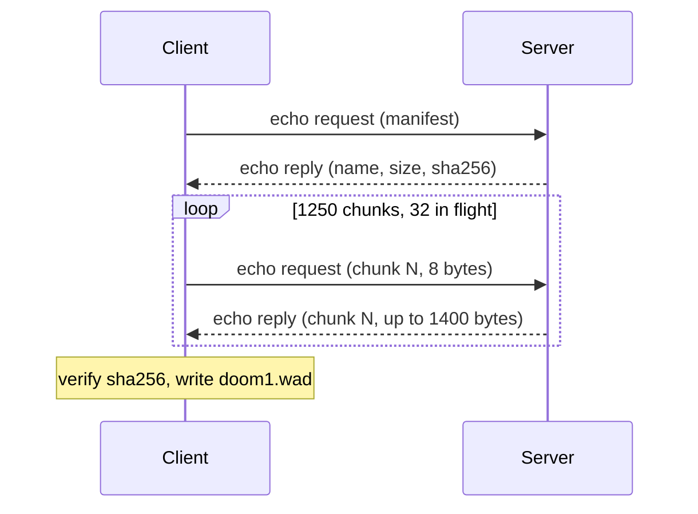

# ping-of-doom

[](https://github.com/gfnogueira/ping-of-doom/actions/workflows/test.yml)


**Shareware Doom, delivered inside ICMP echo replies. Plus a detector that catches it.**


Ping is supposed to answer "are you there?". Here it answers "yes, and here is
the next 1400 bytes of E1M1".

The tunnel is the fun part. The detector is the part worth reusing.

| | |
| --- | --- |
| **What you get** | A Doom tunnel over ping, a detector for it, Suricata rules, a one command lab |
| **Needs** | Docker and Python 3.10+. macOS or Linux |
| **Install** | Nothing. Python standard library only |
| **Transfer time** | About one second |

## Quick start

```sh
git clone https://github.com/gfnogueira/ping-of-doom
cd ping-of-doom
./demo.sh
```

It downloads the shareware WAD, runs a server, a sniffer and a client in
containers, pulls the game over ICMP, runs the detector and opens Doom if
`chocolate-doom` is installed.

## How it works

The game lives on the server, as a plain file. ICMP is only the road it travels on.
That is the difference from doom-over-dns, where the game is stored in public DNS
records. Here nothing is stored in a third party service.



| Detail | Value |
| --- | --- |
| Compression | gzip, level 9 |
| Chunk size | 1400 bytes |
| Chunks | 1250 for `doom1.wad` |
| Request payload | 8 bytes: marker + chunk index |
| Reply payload | marker + index + up to 1400 bytes of data |
| Reliability | window of 32, resend on timeout, sha256 at the end |

ICMP payloads can carry any bytes, which is why tools like ptunnel exist. Nothing
here is new. The point is to see it end to end and learn what it looks like on the wire.

<details>
<summary>Run it step by step, and why it uses containers</summary>

```sh
./fetch-wad.sh                          # shareware doom1.wad, md5 checked
docker compose up -d --build server sniffer
docker compose run --rm client          # rebuilds out/doom1.wad over ICMP
docker compose stop sniffer
python3 -m pod.detect out/capture.pcap
chocolate-doom -iwad out/doom1.wad
```

Raw sockets need root, and the server has to stop the kernel from answering pings
by itself (`net.ipv4.icmp_echo_ignore_all=1`). Docker gives you both without
touching your host.
</details>

## The detector

Same detector, two captures:

| Capture | Echo packets | Verdict |
| --- | --- | --- |
| `ping -c 5 1.1.1.1` and `ping -s 1000 -c 3 1.1.1.1` from a laptop | 16 | ok |
| Doom over ICMP | 2502 | suspicious |

### What it checks

| Check | Catches | Weight |
| --- | --- | --- |
| `reply_mismatch` | Reply is not a copy of the request. A real ping always echoes the payload, a tunnel has to put new data in there | Strong |
| `high_entropy` | Payloads that look compressed or encrypted | Medium |
| `high_rate` | Too many echo requests per second to one host | Medium |
| `big_payload` | Echo payloads larger than a normal ping | Weak, a lead only |

| Verdict | When |
| --- | --- |
| `ok` | Nothing fired |
| `notice` | One check fired, and it was not `reply_mismatch` |
| `suspicious` | `reply_mismatch`, or two or more checks |

The detector ignores this project's `POD1` marker on purpose. Anyone can change a
marker in a minute.

### Options

| Flag | Default | What it does |
| --- | --- | --- |
| `--max-payload` | 100 | Largest normal echo payload, in bytes |
| `--max-rate` | 100 | Echo requests per second before flagging |
| `--min-entropy` | 7.0 | Bits per byte that count as high |
| `--min-hits` | 10 | Packets needed before size, entropy or mismatch fires |
| `--json` | off | Machine readable output |

It reads pcap and pcapng, and exits with code 1 when something is suspicious, so
it fits in a script or a CI job.

<details>
<summary>Run it on your own traffic</summary>

Find the interface your traffic leaves through, capture, ping, analyze.

```sh
# macOS
IF=$(route get 1.1.1.1 | awk '/interface:/ {print $2}')
# Linux
IF=$(ip route get 1.1.1.1 | awk '{for(i=1;i<=NF;i++) if($i=="dev") print $(i+1)}')

sudo tcpdump -i "$IF" -U -w /tmp/icmp.pcap icmp &
ping -c 5 1.1.1.1
sudo pkill -INT tcpdump
python3 -m pod.detect /tmp/icmp.pcap
```
</details>

<details>
<summary>Suricata rules</summary>

`rules/suricata.rules` has four rules: large request, large reply, request burst
and this project's marker. I ran them with Suricata 8.0.8 against the demo capture
and they fire. Suricata cannot compare a reply with its request or measure entropy,
so those two checks only exist in the Python detector.
</details>

## MITRE ATT&CK mapping

This is a lab demo, not an exploit. No vulnerability is involved and there is no CVE.
ICMP echo works as designed. What it shows is a technique attackers use, mapped to
the [ATT&CK](https://attack.mitre.org/) matrix so you can find it in your own
detection coverage.

| Technique | ID | How it shows up here |
| --- | --- | --- |
| [Protocol Tunneling](https://attack.mitre.org/techniques/T1572/) | T1572 | One protocol (a file transfer) carried inside another (ICMP echo) |
| [Non-Application Layer Protocol](https://attack.mitre.org/techniques/T1095/) | T1095 | Data moves over ICMP, with no HTTP, DNS or other application protocol |
| [Ingress Tool Transfer](https://attack.mitre.org/techniques/T1105/) | T1105 | The client pulls a file into the host, which is what the demo does |
| [Exfiltration Over Alternative Protocol](https://attack.mitre.org/techniques/T1048/) | T1048 | The same channel works the other way for data leaving a network |

The detector looks at the network traffic itself, which maps to the ATT&CK data
source Network Traffic Content and Network Traffic Flow.

## Honest limits

| Limit | What it means |
| --- | --- |
| Size gives false positives | `ping -s 1400` trips the size checks, and the Suricata size rules alert on it too. The detector reports size alone as `notice` |
| Not hidden | No obfuscation, no timing tricks. A tunnel that tries to blend in will be harder to catch, and the detector was not tested against one |
| Lab scale | Tunnel tested between containers. Detector also ran on real laptop pings, not on a busy production network |
| Scope | IPv4 and ICMP echo only |

Run the tests with `python3 -m unittest discover`.

## Use it on your own machines only

> Run this in a lab or on machines you own. Moving data through ICMP on a network
> you do not have permission to test can break policy, and in some places the law.

## Credits and license

Inspired by Adam Rice's [doom-over-dns](https://github.com/resumex/doom-over-dns),
which stores Doom in DNS TXT records. Doom is by id Software. The shareware WAD is
free to redistribute and is downloaded at runtime, not stored here.

MIT
