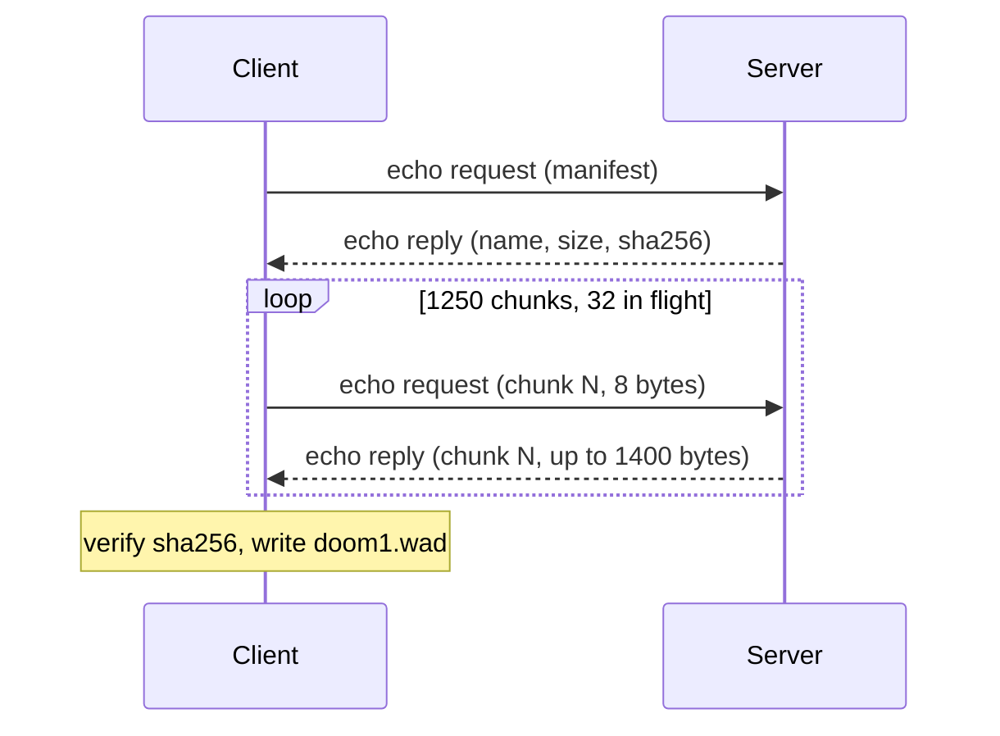

# ping-of-doom

[](https://github.com/gfnogueira/ping-of-doom/actions/workflows/test.yml)


**Shareware Doom, delivered inside ICMP echo replies. Plus a detector that catches it.**


Ping is supposed to answer "are you there?". Here it answers "yes, and here is
the next 1400 bytes of E1M1".

The tunnel is the fun part. The detector is the part worth reusing.

| | |
| --- | --- |
| **What you get** | A Doom tunnel over ping, a detector for it, Suricata rules, a one command lab |
| **Needs** | Docker and Python 3.10+. macOS or Linux |
| **Install** | Nothing. Python standard library only |
| **Transfer time** | About one second |

## Quick start

```sh
git clone https://github.com/gfnogueira/ping-of-doom
cd ping-of-doom
./demo.sh
```

It downloads the shareware WAD, runs a server, a sniffer and a client in
containers, pulls the game over ICMP, runs the detector and opens Doom if
`chocolate-doom` is installed.

## Why this matters

Many networks block most outbound traffic but still allow ping, because admins need
it for diagnostics. If an attacker already controls one machine inside, that open
door can become a way to move data.

| An attacker wants to | What usually stops them | Why ping can slip through |
| --- | --- | --- |
| Bring a tool in | Proxy, download filters | Pings are rarely inspected past their type |
| Take data out | Upload limits, DLP | The echo payload takes any bytes |
| Keep a command channel | Proxy logs, odd connections | Request and reply pairs look like normal ping |

This repo only covers the transport, with Doom as the file. It is a lab for seeing
the traffic and detecting it, not an attack tool.

## How it works

The game lives on the server, as a plain file. ICMP is only the road it travels on.
That is the difference from doom-over-dns, where the game is stored in public DNS
records.



Small request, big reply. That mismatch is what the detector looks for.

<details>
<summary>Protocol details</summary>

| Detail | Value |
| --- | --- |
| Compression | gzip, level 9 |
| Chunk size | 1400 bytes |
| Chunks | 1250 for `doom1.wad` |
| Request payload | 8 bytes: marker + chunk index |
| Reply payload | marker + index + up to 1400 bytes of data |
| Reliability | window of 32, resend on timeout, sha256 at the end |
</details>

<details>
<summary>Run it step by step, and why it uses containers</summary>

```sh
./fetch-wad.sh                          # shareware doom1.wad, md5 checked
docker compose up -d --build server sniffer
docker compose run --rm client          # rebuilds out/doom1.wad over ICMP
docker compose stop sniffer
python3 -m pod.detect out/capture.pcap
chocolate-doom -iwad out/doom1.wad
```

Raw sockets need root, and the server has to stop the kernel from answering pings
by itself (`net.ipv4.icmp_echo_ignore_all=1`). Docker gives you both without
touching your host.
</details>

## The detector

Same detector, two captures:

| Capture | Echo packets | Verdict |
| --- | --- | --- |
| `ping -c 5 1.1.1.1` and `ping -s 1000 -c 3 1.1.1.1` from a laptop | 16 | ok |
| Doom over ICMP | 2502 | suspicious |

| Check | Catches | Weight |
| --- | --- | --- |
| `reply_mismatch` | Reply is not a copy of the request. A real ping always echoes the payload back | Strong |
| `high_entropy` | Payloads that look compressed or encrypted | Medium |
| `high_rate` | Too many echo requests per second to one host | Medium |
| `big_payload` | Echo payloads larger than a normal ping | Weak, a lead only |

Verdicts: `ok` when nothing fires, `notice` when one weak check fires,
`suspicious` on `reply_mismatch` or two or more checks. It reads pcap and pcapng and
exits with code 1 on `suspicious`, so it fits in a script or a CI job.

The detector ignores this project's `POD1` marker on purpose. Anyone can change a
marker in a minute.

<details>
<summary>Options</summary>

| Flag | Default | What it does |
| --- | --- | --- |
| `--max-payload` | 100 | Largest normal echo payload, in bytes |
| `--max-rate` | 100 | Echo requests per second before flagging |
| `--min-entropy` | 7.0 | Bits per byte that count as high |
| `--min-hits` | 10 | Packets needed before size, entropy or mismatch fires |
| `--json` | off | Machine readable output |
</details>

<details>
<summary>Run it on your own traffic</summary>

Find the interface your traffic leaves through, capture, ping, analyze.

```sh
# macOS
IF=$(route get 1.1.1.1 | awk '/interface:/ {print $2}')
# Linux
IF=$(ip route get 1.1.1.1 | awk '{for(i=1;i<=NF;i++) if($i=="dev") print $(i+1)}')

sudo tcpdump -i "$IF" -U -w /tmp/icmp.pcap icmp &
ping -c 5 1.1.1.1
sudo pkill -INT tcpdump
python3 -m pod.detect /tmp/icmp.pcap
```
</details>

<details>
<summary>Suricata rules</summary>

Four rules in `rules/suricata.rules`, checked with Suricata 8.0.8 against the demo
capture.

| SID | Matches | On the demo capture |
| --- | --- | --- |
| 4100001 | Echo request with a payload over 100 bytes | Silent, the demo requests are 8 bytes |
| 4100002 | Echo reply with a payload over 100 bytes | Fires on 1251 replies |
| 4100003 | More than 100 echo requests per second from one source | Fires once |
| 4100004 | This project's `POD1` marker | Fires, but anyone can change a marker |

Suricata cannot compare a reply with its request or measure entropy. Those two
checks only exist in the Python detector.
</details>

## Defenses, cheapest first

You do not need a detector if the tunnel never leaves. Start at the top.

| # | Measure | Why it helps |
| --- | --- | --- |
| 1 | Block outbound echo to the internet, or allow it only to hosts you need | No door, no tunnel |
| 2 | Cap the echo payload size at the firewall. Normal ping is 56 bytes on Linux and macOS, 32 on Windows | A tunnel needs room to carry data |
| 3 | Rate limit echo per source | A file transfer is a burst, a ping is not |
| 4 | Watch ICMP in your IDS or NDR (Suricata, Zeek, a commercial tool) | Catches what the firewall allows |
| 5 | Compare each reply with its request | A real echo reply is a copy. This repo's detector does it |

Keep the ICMP types your network needs, like destination unreachable, so path MTU
discovery keeps working. Blocking all ICMP breaks real things.

To see which layer catches this in your setup, run the lab in an environment you are
authorized to test.

## MITRE ATT&CK mapping

No vulnerability is involved and there is no CVE. ICMP echo works as designed. What
this shows is a technique attackers use, mapped to
[ATT&CK](https://attack.mitre.org/) so you can find it in your own coverage.

| Technique | ID | How it shows up here |
| --- | --- | --- |
| [Protocol Tunneling](https://attack.mitre.org/techniques/T1572/) | T1572 | A file transfer carried inside ICMP echo |
| [Non-Application Layer Protocol](https://attack.mitre.org/techniques/T1095/) | T1095 | Data moves over ICMP, with no HTTP or DNS |
| [Ingress Tool Transfer](https://attack.mitre.org/techniques/T1105/) | T1105 | The client pulls a file into the host |
| [Exfiltration Over Alternative Protocol](https://attack.mitre.org/techniques/T1048/) | T1048 | The same channel works for data leaving a network |

## Honest limits

| Limit | What it means |
| --- | --- |
| Size gives false positives | `ping -s 1400` trips the size checks, and the Suricata size rules alert on it too. The detector reports size alone as `notice` |
| Not hidden | No obfuscation, no timing tricks. A tunnel that tries to blend in will be harder to catch, and the detector was not tested against one |
| Lab scale | Tunnel tested between containers. Detector also ran on real laptop pings, not on a busy production network |
| Scope | IPv4 and ICMP echo only |

Run the tests with `python3 -m unittest discover`.

## Use it on your own machines only

> Run this in a lab or on machines you own. Moving data through ICMP on a network
> you do not have permission to test can break policy, and in some places the law.

## Credits and license

Inspired by Adam Rice's [doom-over-dns](https://github.com/resumex/doom-over-dns),
which stores Doom in DNS TXT records. Doom is by id Software. The shareware WAD is
free to redistribute and is downloaded at runtime, not stored here.

MIT
